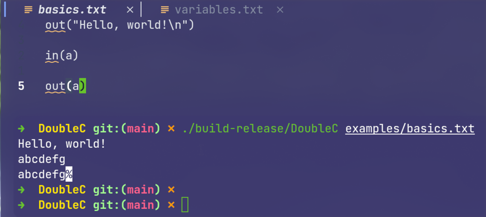
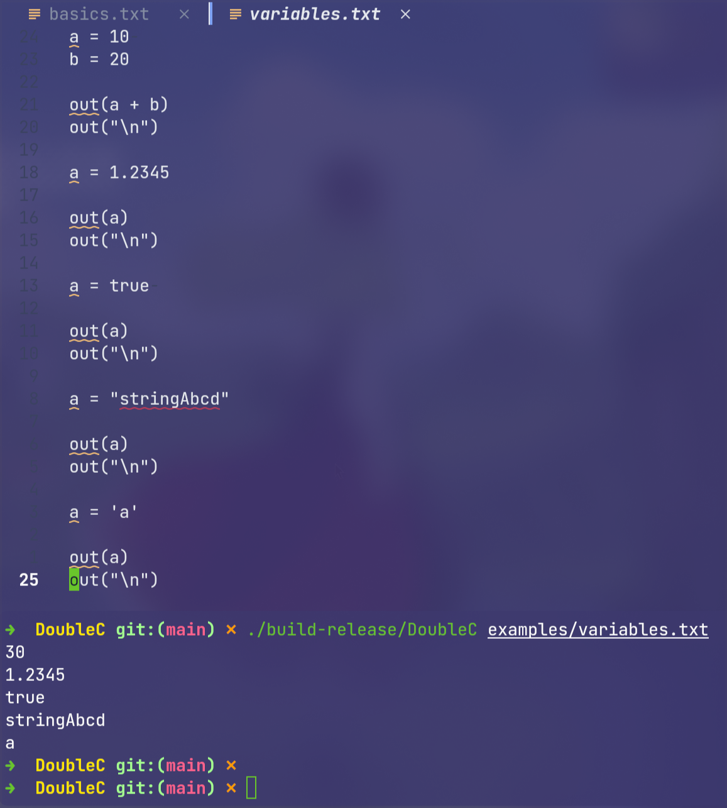
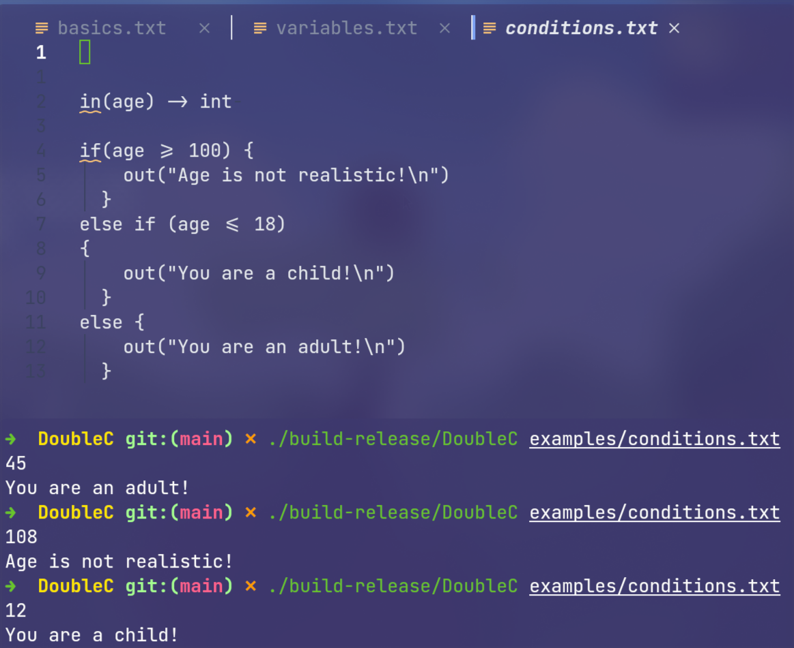
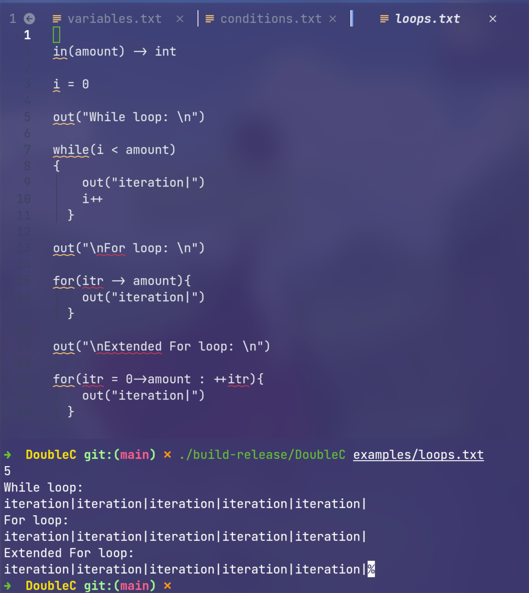
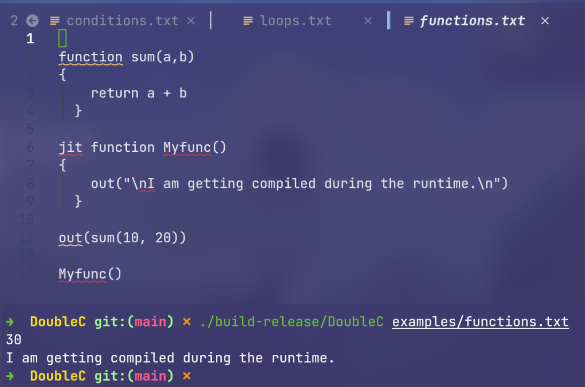
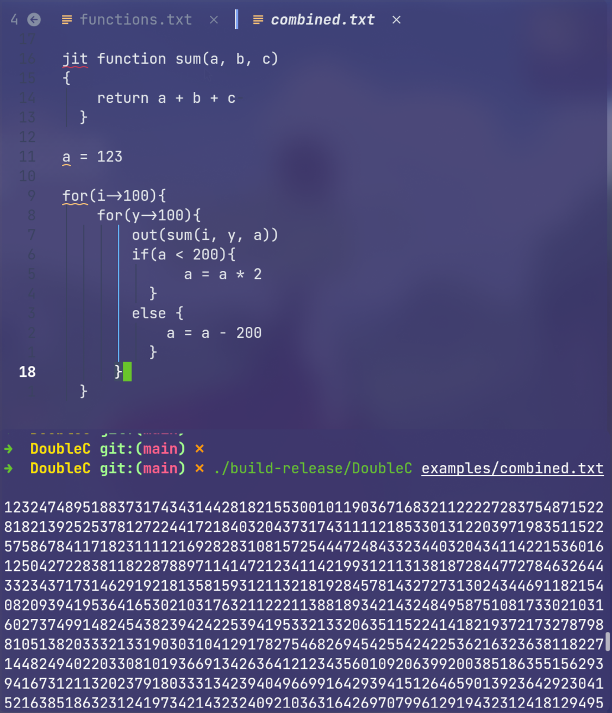

# DoubleC Language Reference

**Language Documentation — Experimental Version**

Welcome to the official language reference for **DoubleC**.

This documentation describes the syntax, features, and runtime behavior of the DoubleC programming language. It is intended to help users understand the language and write their own programs.

> **Project status:** DoubleC is an experimental programming language under active development. Some features and language semantics may change between versions.

---

## Table of Contents

1. [Introduction](#1-introduction)
2. [Getting Started](#2-getting-started)
3. [Language Basics](#3-language-basics)
4. [Operators](#4-operators)
5. [Control Flow](#5-control-flow)
6. [Functions](#6-functions)
7. [Execution Model](#8-execution-model)
8. [Complete Example](#9-complete-example)
9. [Limitations and Project Status](#10-limitations-and-project-status)

---

# 1. Introduction

## 1.1 What is DoubleC?

DoubleC is an independently designed programming language developed from scratch in C++20. The language name is an inspiration of c-style languages, but in reality DoubleC has no connection with traditional c-style programming. It features dynamic typing, a custom bytecode virtual machine, and an optional x86-64 JIT compiler.

The project explores programming language design, compiler architecture, runtime systems, and low-level code generation.

The whole project is fully handwritten, with no AI coding, however AI was used in some researches. 

## 1.2 Design Goals

- Easy to read & simple code
- Good performance relative to other interpreted programming languages 
- Alternative to popular programming languages

## 1.3 Key Features

- Dynamic typing
- Custom bytecode virtual machine
- Optional JIT compilation

## 1.4 Platform Support

| Platform | Architecture | Status |
|---|---|---|
| Linux | x86-64 | Supported |
| Windows | x86-64 | Not Supported |
| Linux | x86-32 | Not Supported |

---

# 2. Getting Started

## 2.1 Requirements

- Linux x86-64
- glibc >= 2.38
- libstdc++ with GLIBCXX_3.4.32 or newer

After meeting the requirements, download the latest release and unpack it.

```bash
tar -xzf DoubleC-linux-x86_64.tar.gz
```

## 2.2 Running a Program

To run a program, run the executable with provided file name.

```bash
./DoubleC program.txt
```

Replace `program.txt` with the path to your source file.

## 2.3 Your First Program

Let's start with a simple Hello World program.

**Source code:**

```text
out("Hello, world!\n")
```

**Execution:**

<p align="center">
  
</p>

## 2.4 Input and Output

For input, use the built-in "in" function. As the first and only argument, function needs a variable, no matter defined or not. The input will be written into that variable, which is string by default. Optionally, you can specify the data type after the "->" operator at the end.

For output, use the built-in "out" function. As the first and only argument, function takes any expression which will printed.

---

# 3. Language Basics

This section introduces the fundamental syntax and language constructs.

## 3.1 Syntax Overview

The language syntax is designed to be simple. End of the line symbolizes the end of instruction, therefore ";" are not needed. Curly brackets are used to describe a block of statements (instructions). Inside those blocks, variables defined outside of them can be used and changed, while variables defined inside them are going to be destroyed after the block ends. 

## 3.2 Variables

Variables are used to store values of any data type. You can assign the variable value of any datatype at any time and make arithmetical, logical and unary operations with it. However, make sure that the value is legit to execute an operation or that will result in runtime error.

**Example:**

```text
a = 10
b = 20

out(a + b)
```

## 3.3 Data Types

Five data types are supported in the latest version. They include int, double, char, bool and string. In c++, those are represented as int64_t, double, char32_t, bool and std::string.

| Type | Description | Example |
|---|---|---|
| Integer | Whole Numbers | `10` |
| Floating-point | Number with floating point | `1.2345` |
| Boolean | Only true and false values | `true` |
| String | A set of characters | `"Hello"` |
| Character | Single character | `'a'` |

## 3.4 Dynamic Typing

Variable data type is determined during the runtime and can be changed at any time. 

**Example:**

```text
a = 10
a = 1.2345
a = true
a = "string"
```

<p align="center">
  
</p>

## 3.5 Type Conversion

To convert one value into another, use the built-in cast operation. 

**Example:**

```text
a = int(347.8)
```

Int will be rounded to the lowest whole number.

---

# 4. Operators

This section describes the operators available in DoubleC.

## 4.1 Arithmetic Operators

| Operator | Description | Example |
|---|---|---|
| `+` | Addition | `a + b` |
| `-` | Subtraction | `a - b` |
| `*` | Multiplication | `a * b` |
| `/` | Division | `a / b` |
| `%` | Taking the residue | `a / b` |

## 4.2 Comparison Operators

| Operator | Description | Example |
|---|---|---|
| `>` | Greater | `a > b` |
| `<` | Less | `a < b` |
| `==` | Equal | `a == b` |
| `!=` | Not equal | `a != b` |
| `>=` | Greater or equal | `a >= b` |
| `<=` | Less or equal | `a <= b` |

## 4.3 Assignment Operators

Only one operator, which is '='. Assigns the value the variable on the left. The only binary operator which is right-oriented (right side is calculated first to allow a = b = c = 0).

## 4.4 Unary operators

| Operator | Description | Example |
|---|---|---|
| `-` | Unary minus | `-a` |
| `!` | Logical Not | `!a` |
| `++` | Pre-increment | `++a` |
| `++` | Post-increment | `a++` |
| `--` | Pre-decrement | `--a` |
| `--` | Post-decrement | `a--` |

## 4.5 Operator Precedence

The order in which operations are made.

1) Unary operations.
2) Arithmetical operations.
3) Comparison operations.
4) Assignment operator
   
---

# 5. Control Flow

Control flow statements determine the order in which program instructions are executed.

## 5.1 Conditional Statements

### If

After "if" statement, the condition needs to be provided in brackets after it. If it is true the block after will be executed, if it is false it will be skip.

### Else If

A statement that comes after the if block. The block after it will be executed in case if the first if condition was false and the current if condition is true.

### Else

A statement that comes after if or else if block. The block next to it will be executed in case if all the conditions before were false. 

**Example:**

```text
in(age) -> int

if(age >= 100) {
    out("Age is not realistic!\n")
}
else if(age <= 18) {
    out("You are a child!\n")
}
else {
    out("You are an adult!\n")
}
```

<p align="center">
  
</p>

## 5.2 While Loops

A while loop, the block next to it will be executed repeatedly as long as condition in brackets is true. 

## 5.3 For Loops

A for loop, a loop with iterator. In the brackets you specify the initial value of iterator (which is by default 0 if not stated) and a final value. The operator "->" or "->=" automatically determines the way iterator is going and determines if increment of decrement will be applied to iterator each iteration.

### Not automatic For Loop

You are still allowed to use other comparison operators such as ">", and so on. In that case the for loop works the same way as while, but the increment operation is applied by default. 

### Extended For Loop

You can optionally specify the initial value of the iterator, and the step (operation to the iterator each iteration). You can also define the iterator before the loop, and the value of it will be used as the initial value of the iterator. After the loop the initial value will be restored.

**Example:**

```text
for(itr -> 10) {
    out("iteration|")
}
```

<p align="center">
  
</p>

# 6. Functions

Functions allow code to be organized into reusable units.

## 6.1 Function Declaration

Function declaration includes function keyword, the name of the function and a the parameters listed in the brackets. The body of the function comes right after that. 

## 6.2 Function Call

To call a function use the function name with a brackets next to it, in the brackets the arguments need to be provided. In case if the function has no arguments, brackets should stay empty inside.

## 6.3 Return Values

The return value can be any, or none (which by default will be integer 0). The dynamic typing allows function to return different data types each time.

## 6.4 JIT Functions

JIT function - the main feature of the language. It allows function to compile during the runtime at the same time as the interpreted version is executed! It is a good habit to mark heavy or highly used functions as jit, as it speeds up the execution by 1.3-2+ times. The function that are called inside jit function will also compile, even if they were not marked jit originally.  

**Example:**

```text
function sum(a, b) {
    return a + b
}

jit function Myfunc() {
    out("Compiled at runtime.\n")
}
```

<p align="center">
  
</p>

---

# 7. Execution Model

DoubleC uses a custom execution engine consisting of a bytecode virtual machine and an optional JIT compiler.

## 7.1 Interpretation Pipeline

The interpretation includes 5 main stages - lexer, parser, analyzer, generator and a VM. 
Each stage does it's specific task with the information provided by the previous stage. For more detailed architecture check out the source code, I provided some comments in header files. However I plan to create a different file with architecture explanation.

## 7.2 Bytecode Virtual Machine

VM executes bytecode instructions one by one, the single bytecode instruction is similar to assembly instruction, but at the higher level. Each instruction has a single operand, unlike the assembly which has several of them. More about bytecode can be explored in source files.

## 7.3 JIT Compiler

JIT compiler runs in a different thread from the VM. It translates bytecode into assembly instructions(nasm) using the asmjit library, and stores the binary representation of the function. Whenever the function is called next time, the binary version will execute.

---

# 8. Complete Example

This section combines several language features into a single program.

## 8.1 Source Code

```text

jit function sum(a, b, c)
{
    return a + b + c
  }

a = 123

for(i->100){
    for(y->100){
        out(sum(i, y, a))
        if(a < 200){
              a = a * 2
          }
        else {
            a = a - 200
          }
      }
  }
```

## 8.2 Explanation

This program summarizes most of the features of DoubleC. The point of the code is to show that highly used functions can be compiled using jit, which would boost the performance. However this exact function does not have a specific point, but to show the example of code.

## 8.3 Execution Result

<p align="center">
  
</p>

---

# 9. Limitations and Project Status

DoubleC is an experimental project, and some features are still under development.

## 9.1 Current Limitations

- Functions cannot be defined inside other functions, however they can be defined inside other blocks
- Break and continue statements are currently not supported.
- Constant and global variables are not supported.

## 9.2 Planned Features

- C and C++ interoperability
- Optimization
- Other platforms support
- Broader functionality
- Object-oriented programming

## 9.3 Documentation Status

This documentation describes the current experimental implementation of DoubleC. Language features and behavior may change as development progresses.

---

**DoubleC — Language Reference**

[GitHub Repository](https://github.com/nn13sn/doubleC) · [Releases](https://github.com/nn13sn/doubleC/releases)
